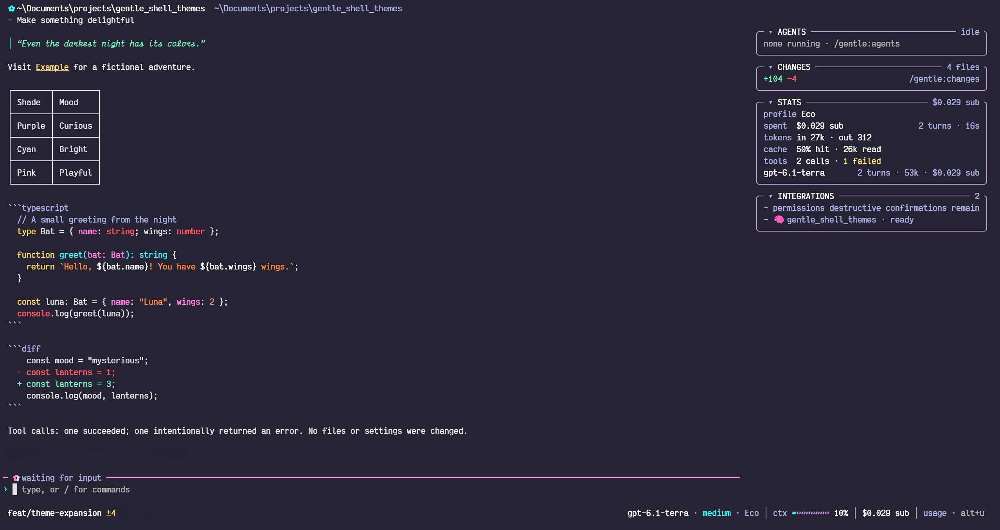
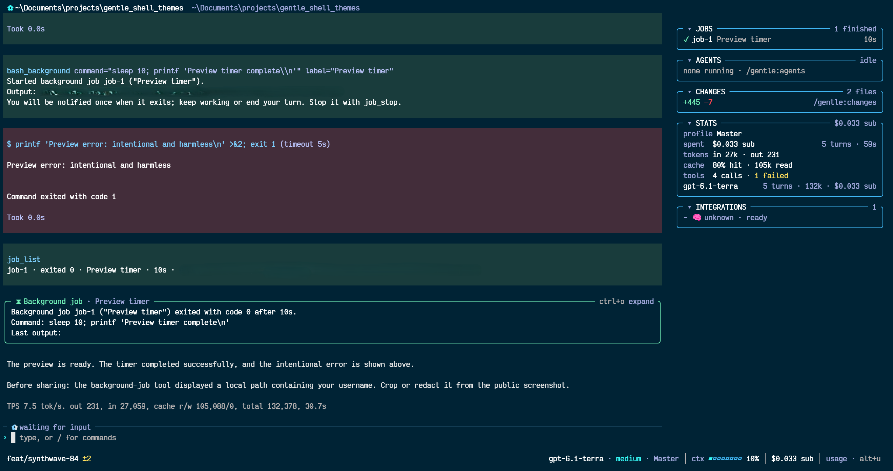

# Gentle Shell Themes

An unofficial collection of Pi themes for [Gentle Shell](https://github.com/Gentleman-Programming/gentle-shell), inspired by various themes from Visual Studio Code.

## Contents

- [Preview](#preview)
- [Install and use a theme](#install-and-use-a-theme)
    - [Clone the repository](#1-clone-the-repository)
    - [Find your agent home](#2-find-your-agent-home)
    - [Copy the theme](#3-copy-the-theme)
    - [Select the theme](#4-select-the-theme)
    - [Update or recover](#update-or-recover)
- [Terminal appearance](#terminal-appearance)
- [Credits and attribution](#credits-and-attribution)
- [License](#license)

## Preview

### SynthWave '84 - unofficial Gentle Shell adaptation



### SynthWave '84 Blues - unofficial Gentle Shell adaptation



## Install and use a theme

You need Git and an existing Gentle Shell installation. You can install `synthwave-84`, `synthwave-84-blues`, or both; the themes can coexist.

### 1. Clone the repository

In PowerShell on Windows, or a terminal on Linux or macOS, run:

```sh
git clone https://github.com/josuerodcat90/gentle-shell-themes.git
cd gentle-shell-themes
```

### 2. Find your agent home

Run this in the same environment you use to launch Gentle Shell:

```sh
gentle-shell home
```

The output includes a mode and a path, for example `isolated <agent-dir>`. Copy only the path, not the mode. The usual isolated home is `~/.gentle-shell/agent`, but linked or custom homes can differ. Use the reported path rather than assuming a location.

### 3. Copy the theme

Open the path reported by `gentle-shell home` in your file manager. Open the `themes` folder inside it, or create it if it does not exist. You may need to show hidden folders in your file manager.

From the cloned repository's `themes` folder, copy either or both theme files into the agent home's `themes` folder, depending on which themes you want to use.

If a file with the same name already exists in the destination, inspect and back it up before replacing it. This does not edit `settings.json`; the repository copy remains the source of truth.

### 4. Select the theme

Open Gentle Shell and choose `synthwave-84` or `synthwave-84-blues` through `/gentle:customize` or Pi's `/settings` theme selector. If a newly added theme is not listed, run `/reload` or restart Gentle Shell. To return to your previous theme, select it through the same interface.

### Update or recover

To update, obtain the desired repository version, back up any installed file with the same name, and copy the new JSON to the reported agent home's `themes` directory. After a reinstall or home change, run `gentle-shell home` again before copying. A complete Gentle Shell uninstall may remove an isolated agent home, so keep your repository copy separately. Avoid installing the same theme through multiple sources at once, as duplicate names can conflict.

## Terminal appearance

To reproduce the contrast shown in the previews, configure your terminal profile with these background colors:

| Theme               | Terminal background |
| ------------------- | ------------------- |
| SynthWave '84       | `#262335`           |
| SynthWave '84 Blues | `#002335`           |

The previews also use `#E5E5E5` as the terminal foreground (rather than pure white) and the [Victor Mono](https://rubjo.github.io/victor-mono/) font. These settings are optional; your terminal's foreground can affect text that uses its default color.

**In Windows Terminal**, set the background and foreground colors in the selected profile's color scheme. Optionally, configure the profile's `font` object to enable font ligatures. The following example uses Victor Mono; other fonts with ligature support, such as Fira Code, can also be used by changing `face`:

```jsonc
"font": {
  "face": "Victor Mono",
  "size": 12, // or your preferred font size
  "weight": "normal", // or your preferred font weight
  "features": {
    "liga": 1,
    "calt": 1,
    "dlig": 1
  }
}
```

Merge this object into your existing profile in Windows Terminal's `settings.json`; do not replace the entire file. The size and weight are optional preferences, and the effect of each feature depends on font support. See the [Windows Terminal profile appearance documentation](https://learn.microsoft.com/en-us/windows/terminal/customize-settings/profile-appearance) for details.

On macOS and Linux, configure these settings in your terminal application's preferences; the steps vary by application.

## Credits and attribution

These themes are unofficial adaptations of:

- [SynthWave '84](https://github.com/robb0wen/synthwave-vscode), created by Robb Owen. Its [MIT notice](LICENSES/synthwave-84-MIT.txt) is preserved here.
- [SynthWave '84 Blues](https://github.com/sabrsorensen/synthwave-blues-vscode-theme), adapted by sabrsorensen from SynthWave '84. Its [MIT notice](LICENSES/synthwave-84-blues-MIT.txt) is preserved here.

This project is not affiliated with or endorsed by the original authors or the Gentle Shell project.

## License

New work in this repository is licensed under the [MIT License](LICENSE). The licenses of the original projects remain applicable to their respective material.
